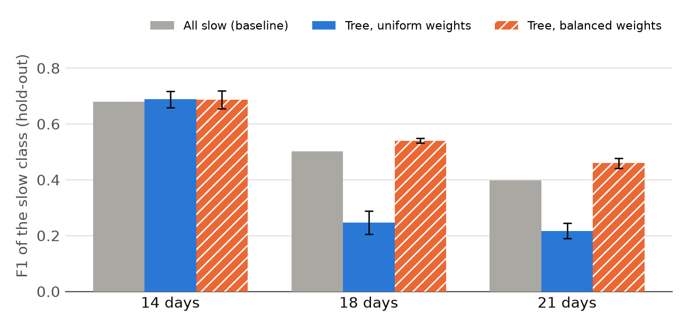
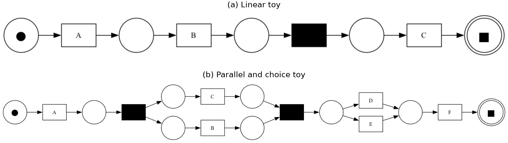

# Motivation and Scientific Background {#sec-motivation}

Conformance checking compares behaviour recorded in an event log with behaviour accepted by a process model in order to identify commonalities and deviations [@Aalst16]. Alignment-based conformance checking sees deviations as *log moves*, representing observed behaviour that cannot be reproduced by the model, and *model moves*, representing modelled behaviour that was not observed. The course topics on resource and temporal conformance also check conformance, but against constraints from natural-language descriptions, whereas we compare control flow with a Petri net.

Deviations from a normative process model are not directly linked with poor process performance. Dees et al. [@Dees2017] propose a methodology in which deviations identified through conformance checking are related to a case-level KPI using classification or regression trees, and deviation patterns associated with good KPI values can help to enhance the model. The method complements decision mining: where decision mining uses trees and rules to explain the routing at decision points, we explain a case-level KPI by the deviations from the model. Predictive process monitoring also links process features to outcomes, but it predicts them for ongoing cases, whereas our rules are interpretable by design and aim to improve the process.

This assignment implements the deviation analysis component of this method: optimal alignments against a Petri net yield deviation features, which are related to case throughput time.

As a concrete use case, the loan application process of a Dutch financial institution from the BPI Challenge 2017 [@vanDongen2017BPIC] is taken, restricted to the denied applications. A process owner may ask which deviations from the process go together with slow denials, and whether the process should allow or forbid them. The deviation analysis answers this question.

Related work covers parts of this setting. Recent work lifts event-level deviations to process-level patterns, such as activities that are inserted, skipped, repeated, replaced or swapped [@grohs2024beyond]. The BPIC studies that we reviewed do not link deviations to a KPI: Carvallo et al. [@carvallo2017applying] analyse throughput times descriptively and leave denied applications out of their deeper analysis, and Ryu et al. [@ryu2017analysis] apply decision trees at the decision points but obtain usable results at only one of three. Our modelling choices follow tree-based process mining practice [@park2023explainable]: grid search with cross-validation on the F1 score, and pruning for interpretability. To our knowledge, none of these studies relates alignment-based deviation features to a throughput KPI for the Denied subset, which is the gap that this work addresses.

# Conceptual Approach

## Overview

The artefact implements the deviation analysis step of Dees et al. [@Dees2017]. It takes an event log in XES format and a Petri net in PNML format as input. The log must provide a case notion, an activity label for every event and a reliable timestamp for every event, because both the throughput time and the alignments depend on them. Resources and further attributes are not used. The Petri net is the normative model against which the log is compared. The artefact returns a set of classification rules that relate deviations to throughput time, together with the traces of the log that satisfy each rule.

@fig-pipeline shows the four steps. The correctness of the implementation is tested against hand-built gold standards (@sec-evaluation).

```{mermaid}
%%| label: fig-pipeline
%%| fig-width: 6.5
%%| fig-cap: "The artefact turns a log and a model into rules in four steps."
flowchart LR
  A["Log (XES)<br/>+ net (PNML)"] --> B["1 KPI<br/>per trace"]
  B --> C["2 Align<br/>and encode"]
  C --> D["3 Classification<br/>tree"]
  D --> E["4 Rules<br/>+ trace sets"]
```
\clearpage
## The Pipeline {#sec-kpi}

**Step 1: KPI definition and enrichment:** The first step attaches a key performance indicator (KPI) to every trace, so that deviations can later be related to how long a case takes. The brief prescribes throughput time. For a trace $\sigma$, it is the elapsed time between the first and the last event [@Dees2017]:

$$
\kappa(\sigma) = t(\text{last event of }\sigma) - t(\text{first event of }\sigma).
$$

The artefact stores $\kappa(\sigma)$ in days as the case attribute `throughput_time`, and lower values are better. The implementation takes the earliest and the latest timestamp of the trace, which equals the definition for chronologically ordered traces. \bigskip

\noindent

**Step 2: Alignment and encoding:** The second step measures how each trace deviates from the Petri net. An alignment maps a trace onto a run of the net. Every position is a synchronous move (trace and model agree), a log move or a model move, as defined in [@sec-motivation; @Aalst16]. @tbl-align shows all three for a short trace.

| Position | 1           | 2          | 3            | 4           |
|----------|-------------|------------|--------------|-------------|
| Trace    | A           | A          | $\gg$        | C           |
| Model    | A           | $\gg$      | B            | C           |
| Move     | synchronous | log move A | model move B | synchronous |

: Log moves and model moves arise where a trace and the model disagree. The table shows one alignment of the trace A, A, C against the model A, B, C, in which the symbol $\gg$ marks a skipped position. {#tbl-align}

An alignment is optimal when it has the minimal number of deviations on visible transitions, and moves on silent transitions do not count [@Dees2017]. The alignments are computed with PM4Py [@Berti2019] (version 2.7.23.8), whose default cost function and state-equation A\* solver realise this criterion: log moves and model moves on visible activities cost 10000, synchronous moves cost 0, and silent moves cost 1 as a tie-breaker. A trace can have several optimal alignments and the solver returns one. Dees et al. argue that this does not affect the applicability of the methodology when the log contains many traces [@Dees2017] (see @sec-limitations).

Each alignment is then encoded as a vector of counts. For each of the 54 visible activities of the net, one feature records the number of model moves and one the number of log moves, as the brief specifies, giving 108 features per trace. An activity is an event name including its lifecycle suffix, for example `W-Call-after-offers-suspend`. Synchronous moves carry no deviation and are not features. The counts replace the activity sequence as representation, since the 3,093 traces contain 2,038 distinct sequences. \bigskip

\noindent

**Step 3: Classification:** The third step relates the encoded deviations to the KPI with a classification tree [@Dees2017]. The brief asks for a classification tree, so a trace is slow if its throughput time exceeds a cutoff of 14 days, and fast otherwise. The cutoff lies close to the median of 14.43 days, yields 1,501 fast and 1,592 slow traces, and was fixed before any tree was fitted. A rule therefore describes deviations that go with a throughput time above or below this cutoff. It does not show that they cause the delay or how large the delay is, and a different cutoff can give different rules, so @sec-evaluation compares three cutoffs.

The tree is fitted on a stratified random sample of 75 percent of the traces, and the remaining 25 percent is held out for evaluation. A grid search with five-fold cross-validation on the training part selects the maximum depth (2 to 5), the minimum leaf size (5, 10 or 20) and the cost-complexity pruning parameter [@breiman1984classification] (0, 0.001, 0.01 or 0.1). This gives 48 combinations, and the grid was fixed before any scores were inspected. The selection criterion is the F1 score of the slow class. Pruning limits the number of rules. Unpruned trees produced at least twenty rules, which is too many to interpret. \bigskip

\noindent

**Step 4: Rules and trace subsets:** The fourth step reads the fitted tree as rules. Every path from the root to a leaf is a conjunction of threshold conditions on move counts, and each leaf is one rule. The counts are integers, so a condition such as `log_move_X <= 0.5` means that activity X never occurs as a log move, and `log_move_X > 0.5` means that it occurs at least once. A rule predicts the class that the tree assigns to its leaf. For each rule, the artefact lists the identifiers of all traces that satisfy its conditions, including those whose actual class differs from the predicted one. The rules and trace lists cover all 3,093 traces, whereas precision and recall are computed on the hold-out set only.

# Implementation

The artefact is implemented in Python 3.12 in three packages that mirror the pipeline: data loading with KPI enrichment, alignment with encoding, and classification with rule extraction. PM4Py [@Berti2019] loads the XES log and the PNML net and computes the alignments, pandas holds the encoding table, and scikit-learn [@pedregosa2011scikit] fits the tree and performs the grid search. A single entry point, `src/main.py`, runs all four steps. It requires the cutoff in days and accepts the hold-out fraction, the random seed (default 0, so that a run is reproducible), an optional sample size for development and the output paths. It writes the encoding table, the rule table and the rule-to-trace assignments as CSV files, and `requirements.txt` pins the dependencies. Scripts in the `scripts` directory generate the two toy logs, compare their results with the hand-written gold standards, and compare cutoffs, seeds and lifecycle encodings on the real log ([Appendix](#sec-appendix)).

# Evaluation Design and Results {#sec-evaluation}

## Data and evaluation design

The evaluation uses the Denied subset of the BPIC 2017 log [@vanDongen2017BPIC] and the Petri net provided with the assignment. The subset has 3,093 traces over 54 visible activities, and throughput times between 0.006 and 259.9 days, with a median of 14.43 and a mean of 17.0 days. A sample of the log served only during development, and all reported numbers use the full log.

The brief asks how well the approach generates the optimal alignments and how well it finds the right classification rules. We therefore evaluate in two ways. The correctness of the alignments and of the rules is tested on two small artificial logs against hand-built gold standards (@sec-gold). On the real log no gold standard for the rules exists, so we measure how well the tree separates slow from fast traces on a stratified hold-out of 25 percent of the traces, with the precision, recall and F1 of the slow class. Each result is compared with the baseline that labels every trace as slow, which has a precision equal to the share of slow traces, a recall of 1, and an F1 of $2p/(1+p)$ for slow share $p$. The main setting is the cutoff of 14 days. Cutoffs of 18 and 21 days test how sensitive the results are to this choice. At these cutoffs the slow class is a minority, so we also compare uniform class weights with balanced weights. These variants are a sensitivity analysis and not part of the grid that was fixed in advance. A single random split can mislead, so every setting is run with the seeds 0 to 3, and we report the mean and the standard deviation. The seeds reuse the same 3,093 traces, so the standard deviation measures the sensitivity to the split and not independent replication.

## Gold standards for alignments and rules {#sec-gold}

The correctness of the alignments and the rules is tested against gold standards built by hand, because the traces of the real log are too long to align manually. Two small logs with their nets serve this purpose: a linear net with five traces, and a net with six traces that adds a parallel block and an exclusive choice. The correct move counts were derived by hand before the artefact was run. For the rules, the throughput times of selected traces were planted so that one deviation separates slow from fast traces, and the recovered trace sets are compared with the planted ones. Both toys reproduce the hand-derived move counts exactly (5 of 5 and 6 of 6 traces). Counting every move of the gold standard as one item, the aligner finds all gold moves and adds none, so the precision and the recall of the alignments are 1.0 on both toys. Both planted rules are recovered with precision and recall of 1.0 (@fig-toys and @tbl-gold in the appendix).

## Results on the real log {#sec-results}

At the cutoff of 14 days, the tree with seed 0 has two rules, a precision of 0.563, a recall of 0.970 and an F1 of 0.712 (@tbl-robust). This is the fit that we read as rules, but it is also the most favourable of the four splits. Averaged over four seeds, the F1 of 0.688 is only slightly above the 0.680 of the baseline, and the selected tree has between 2 and 14 rules: seeds 0 and 3 give the two-rule tree, whereas seeds 1 and 2 give trees with 11 and 14 rules and a recall of about 0.74, because the grid search chose depth 2 with $\alpha$ = 0.01 for seeds 0 and 3, but depth 4 or 5 with $\alpha \le 0.001$ for seeds 1 and 2 (@tbl-seeds in the appendix). The only split of the two-rule tree is the log move of `W-Call-after-offers-suspend`. The net allows one suspension of this task, so a log move means an additional suspension. The 389 traces without it are slow in 16 percent of the cases, and the 2,704 traces with it (87 percent of all traces) in 57 percent, only 5 points above the base rate of 51.5 percent, so the association is modest.

At the higher cutoffs the slow class is a minority, and the two class weights show a trade-off (@tbl-robust, @fig-f1). Uniform weights give a precision of 0.48 and 0.61, clearly above the base rates of 0.33 and 0.25, but a recall of only 0.17 and 0.13. Balanced weights reach a recall of about 0.8 and an F1 above the baseline (0.540 against 0.501, and 0.460 against 0.397), but their precision is only about 7 points above the base rate. When the grid search was allowed to choose the class weight, it selected the balanced weight in all four seeds at both cutoffs. In the trees with seed 0, the clearest slow rules at 18 and 21 days involve repeated log moves of `O-Refused`: three or more at 18 days, in leaves of 29 to 55 traces with 59 to 71 percent slow traces, and at 21 days in combination with `O-Created`, in a leaf of 113 traces with 60 percent slow traces.

| Cutoff (slow) | Weights | Precision | Recall | F1 | Base F1 | Rules |
|:------------|:---------|:-------------|:--------------|:--------------|:---------|:------------|
| 14 d (51.5%) | seed 0 | 0.563 | 0.970 | 0.712 | 0.680 | 2 |
| 14 d (51.5%) | uniform | 0.582 ± 0.019 | 0.855 ± 0.133 | 0.688 ± 0.030 | 0.680 | 7.3 (2–14) |
| 18 d (33.4%) | uniform | 0.483 ± 0.104 | 0.171 ± 0.046 | 0.247 ± 0.042 | 0.501 | 12.3 (4–22) |
| 18 d (33.4%) | balanced | 0.403 ± 0.016 | 0.826 ± 0.106 | 0.540 ± 0.009 | 0.501 | 8.0 (2–12) |
| 21 d (24.8%) | uniform | 0.608 ± 0.021 | 0.133 ± 0.020 | 0.217 ± 0.027 | 0.397 | 11.0 (8–18) |
| 21 d (24.8%) | balanced | 0.320 ± 0.014 | 0.814 ± 0.030 | 0.460 ± 0.018 | 0.397 | 12.3 (11–14) |

: Hold-out scores of the slow class for each cutoff. The first row is the fit with seed 0 (uniform weights), all other rows are the mean ± standard deviation over four seeds. At 14 days the classes are nearly balanced, so only uniform weights are used. {#tbl-robust}

{#fig-f1 width="45%"}

A likely reason for the weak results lies in the deviation features and the net. First, the net does not describe the denial path of these cases: the log moves of **`A-Denied`** , **`O-Returned`** and **`O-Refused`** occur in 91 to 94 percent of the traces and are almost never model moves, and the net allows one suspension of the `W-Call-after-offers` while 77.5 percent of the traces have two. Deviations are therefore the norm, and they separate slow from fast traces poorly. Most remaining features are rare: 91 of the 108 occur in fewer than 5 percent of the traces, which explains why the trees differ per seed. Second, 51 percent of all deviation counts are suspend, resume or abort moves, which the net does not model. Merging the lifecycle variants of a task (@tbl-merge) changes no F1 by more than one standard deviation, so these features alone do not explain the result. Third, alignments use the order of the events and not their timestamps, so they cannot see waiting time. A case may be slow mainly because the customer takes to long to respond, but we did not test this. We also did not test whether a different net or model would extract more from the same data, so these explanations remain hypotheses. In our experiments the class weights change the F1 far more than merging does, so the model settings matter more than the feature encoding.

# Limitations and Future Work {#sec-limitations}

The approach has several design limitations. Discretising throughput time at one cutoff discards the magnitude of the KPI, whereas Dees et al. use a regression tree for the numeric KPI of their UWV case [@Dees2017]. Throughput time is elapsed wall-clock time, so it includes non-working periods and does not separate waiting from processing. The features depend on the one optimal alignment that the solver returns, which was not tested here. Activities are lifecycle events, such as the suspension or abortion of a work item, so many features describe interruptions and are hard to read as process deviations, and merging the variants did not make the rules easier to interpret (@sec-results). The trace subset of a rule also contains every trace that satisfies its conditions, including misclassified ones, whereas Dees et al. keep only correctly classified traces [@Dees2017].

The results add three limitations that weigh most for the reliability of the findings. First, the tree improves the F1 of the all-slow baseline at 14 days by only 0.008, so the two-rule tree is not a stable explanation. Second, the evaluation covers a single dataset, with four splits of the same traces, and no published BPIC 2017 study with the same setup exists for a comparison. Third, nearly every trace deviates (Section 4.3), so deviations are the norm and not exceptions, and the root split may reflect a net that is too strict about suspensions. Less critical are the trade-off between precise rules with low recall and high recall with weak precision at higher cutoffs, and the use of control flow only, since the topic description also names violations of data guards, such as the loan amount.

Future work follows from these limitations. A net that better reflects the observed process, for example one rediscovered from the event log or one that counts only real actions and not the pausing and resuming of work items. would show whether deviations explain the throughput time once normal behaviour is no longer counted as a deviation. A rediscovered net is descriptive and no longer normative, so it should be built from a training part of the log. Time-aware features such as the days waited after a suspension, would capture the waiting that alignments ignore. Comparing only the fastest and slowest quarter, or a regression tree on the continuous KPI, would avoid the arbitrary cutoff. Sampling several optimal alignments would test the solver's influence.

\newpage

# Technology Statement {.unnumbered}

<!-- RICK: template wording is the mandatory course text. Confirm with the team: the exact tool and version (add it if known), that no other AI tool was used, and that the "parts affected" matches how each of you worked. -->

During the preparation of this work, we used Claude Sonnet 5.5 in order to assist with writing, debugging and testing the Python code, to improve the clarity, grammar and style of the text, and to reduce the number of words so that the report fits the page limit. The following parts of the assignment were affected by AI tool usage: the Implementation (code and scripts) and the wording of all sections of the report, including the shortening of Motivation, Implementation, Results and Limitations. After using this tool, Rick de Rijk, Thom Verzantvoort, Stefan Vonk and Tycho van Rooij evaluated the validity of the tool's outputs, including the sources that generative AI tools have used, and edited the content as needed. As a consequence, Rick de Rijk, Thom Verzantvoort, Stefan Vonk and Tycho van Rooij take full responsibility for the content of their work.

# References

::: {#refs}
:::

\newpage

# Appendix {#sec-appendix .unnumbered}

## Gold standards for alignments and rules {.unnumbered}

On both toys, a tree of depth 1 fitted on the planted throughput times recovers the planted rule `log_move_B` at least once, so slow, with a precision and recall of 1.0. In the linear toy the slow traces are t3 and t4, and in the parallel toy only p4. The traces t2, t5, p3, p5 and p6 deviate from the net but stay fast, so the rule is not "any deviation".

{#fig-toys width="90%"}

| Trace | Deviation | Gold = aligner | Days | Slow |
|:-----------------------|:------------------------|:------------------------|:--------|:--------|
| t1: A B C | fits | none | 5 | no |
| t2: A C | B missing | model move B | 8 | no |
| t3: A B B C | extra B | log move B | 20 | yes |
| t4: A B B B C | two extra B | log move B ×2 | 30 | yes |
| t5: A A C | extra A, B missing | model move B, log move A | 6 | no |
| p1: A B C D F | fits | none | 5 | no |
| p2: A C B E F | fits (C before B, branch E) | none | 6 | no |
| p3: A B D F | C missing | model move C | 8 | no |
| p4: A B B C D F | extra B | log move B | 25 | yes |
| p5: A B C D | F missing | model move F | 7 | no |
| p6: A A B C E F | extra A | log move A | 9 | no |

: Gold standard of the toy logs. Each trace was aligned by hand before the artefact was run, and the move counts of the aligner equal the hand counts in all 11 traces. Days are the throughput times planted for the rule check, with a cutoff of 10 days. {#tbl-gold}

## Lifecycle merge experiment {.unnumbered}

We tested whether the encoding of lifecycle events affects the results. The unmerged encoding has one feature per lifecycle variant (108 features). The pause/execution encoding sums the suspend and resume counts of each work task into one pause feature and the schedule, start and complete counts into one execution feature (74 features). The all merged encoding sums all lifecycle variants of a task, including `-ate-abort` and `-withdraw`, into one feature per move kind (46 features). The A- and O- activities are unchanged and the alignments are not recomputed. All encodings use the same cutoffs, seeds 0 to 3, grid and class weights. @tbl-merge shows the hold-out scores as mean ± standard deviation over four seeds, and the number of rules as mean (minimum to maximum). Pause/execution changes no F1 by more than one standard deviation; its 14-day uniform tree with seed 1 is a single rule that labels every trace as slow. All merged gives the same two-rule tree in every seed at 14 days with uniform weights (F1 0.713 ± 0.011), but it does not improve the other settings, and balanced weights at 21 days are slightly lower (0.444 against 0.460). We therefore do not consider any encoding better.

| Cutoff | Weights | Encoding | Precision | Recall | F1 | Rules |
|:--------|:---------|:---------------|:-------------|:--------------|:--------------|:------------|
| 14 days | uniform | unmerged | 0.582 ± 0.019 | 0.855 ± 0.133 | 0.688 ± 0.030 | 7.3 (2–14) |
| 14 days | uniform | pause/execution | 0.560 ± 0.034 | 0.921 ± 0.119 | 0.692 ± 0.026 | 4.8 (1–14) |
| 14 days | uniform | all merged | 0.571 ± 0.009 | 0.948 ± 0.017 | 0.713 ± 0.011 | 2.0 (2–2) |
| 14 days | balanced | unmerged | 0.584 ± 0.023 | 0.848 ± 0.141 | 0.687 ± 0.032 | 7.0 (2–13) |
| 14 days | balanced | pause/execution | 0.583 ± 0.021 | 0.854 ± 0.134 | 0.689 ± 0.030 | 5.3 (2–10) |
| 14 days | balanced | all merged | 0.579 ± 0.022 | 0.890 ± 0.114 | 0.698 ± 0.026 | 4.3 (2–11) |
| 18 days | uniform | unmerged | 0.483 ± 0.104 | 0.171 ± 0.046 | 0.247 ± 0.042 | 12.3 (4–22) |
| 18 days | uniform | pause/execution | 0.500 ± 0.074 | 0.184 ± 0.042 | 0.264 ± 0.034 | 16.8 (4–21) |
| 18 days | uniform | all merged | 0.500 ± 0.053 | 0.169 ± 0.014 | 0.252 ± 0.020 | 13.5 (9–18) |
| 18 days | balanced | unmerged | 0.403 ± 0.016 | 0.826 ± 0.106 | 0.540 ± 0.009 | 8.0 (2–12) |
| 18 days | balanced | pause/execution | 0.403 ± 0.016 | 0.826 ± 0.106 | 0.540 ± 0.009 | 8.8 (2–12) |
| 18 days | balanced | all merged | 0.404 ± 0.015 | 0.808 ± 0.113 | 0.536 ± 0.009 | 8.0 (2–12) |
| 21 days | uniform | unmerged | 0.608 ± 0.021 | 0.133 ± 0.020 | 0.217 ± 0.027 | 11.0 (8–18) |
| 21 days | uniform | pause/execution | 0.592 ± 0.045 | 0.124 ± 0.017 | 0.204 ± 0.022 | 11.8 (8–22) |
| 21 days | uniform | all merged | 0.577 ± 0.039 | 0.130 ± 0.027 | 0.211 ± 0.033 | 11.5 (7–20) |
| 21 days | balanced | unmerged | 0.320 ± 0.014 | 0.814 ± 0.030 | 0.460 ± 0.018 | 12.3 (11–14) |
| 21 days | balanced | pause/execution | 0.320 ± 0.014 | 0.814 ± 0.030 | 0.460 ± 0.018 | 11.5 (10–14) |
| 21 days | balanced | all merged | 0.332 ± 0.034 | 0.712 ± 0.163 | 0.444 ± 0.023 | 13.3 (8–19) |

: Three lifecycle encodings. Hold-out scores of the slow class, mean ± standard deviation over four seeds. {#tbl-merge}

## Results per seed {.unnumbered}

| Cutoff  | Seed | Depth | Leaf | $\alpha$ | Rules | Precision | Recall | F1    |
|:--------|:-----|:------|:-----|:---------|:------|:----------|:-------|:------|
| 14 days | 0    | 2     | 5    | 0.01     | 2     | 0.563     | 0.970  | 0.712 |
| 14 days | 1    | 5     | 5    | 0.001    | 11    | 0.600     | 0.736  | 0.661 |
| 14 days | 2    | 4     | 20   | 0        | 14    | 0.597     | 0.744  | 0.662 |
| 14 days | 3    | 2     | 5    | 0.01     | 2     | 0.568     | 0.970  | 0.716 |
| 18 days | 0    | 2     | 5    | 0.01     | 2     | 0.381     | 0.985  | 0.549 |
| 18 days | 1    | 5     | 20   | 0.001    | 12    | 0.402     | 0.764  | 0.527 |
| 18 days | 2    | 4     | 10   | 0.001    | 9     | 0.416     | 0.768  | 0.540 |
| 18 days | 3    | 4     | 5    | 0.001    | 9     | 0.413     | 0.788  | 0.542 |
| 21 days | 0    | 4     | 10   | 0.001    | 11    | 0.337     | 0.854  | 0.484 |
| 21 days | 1    | 4     | 10   | 0.001    | 12    | 0.307     | 0.786  | 0.442 |
| 21 days | 2    | 4     | 20   | 0        | 14    | 0.325     | 0.797  | 0.462 |
| 21 days | 3    | 5     | 20   | 0.001    | 12    | 0.312     | 0.818  | 0.452 |

: Grid-search choices and hold-out scores of the slow class for each seed. Depth, Leaf (minimum samples per leaf) and $\alpha$ (cost-complexity pruning) are the grid-search choices, and Rules is the number of leaf rules. The trees at 14 days use uniform weights, those at 18 and 21 days balanced weights. {#tbl-seeds}
