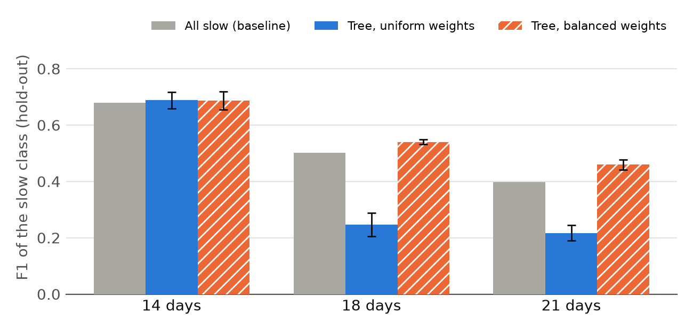
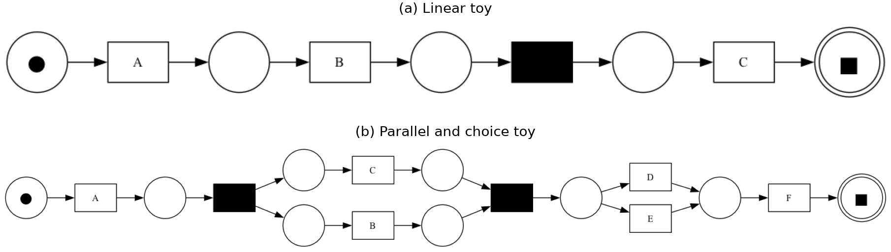

\newpage

# Motivation and Scientific Background

Conformance checking compares behaviour recorded in an event log with behaviour accepted by a process model in order to identify commonalities and deviations [@Aalst16]. Alignment-based conformance checking sees deviations as *log moves*, representing observed behaviour that cannot be reproduced by the model, and *model moves*, representing modelled behaviour that was not observed. The course topics on resource and temporal conformance also check conformance, but against constraints from natural-language descriptions, whereas we compare control flow with a Petri net.

Deviations from a normative process model are not directly linked with poor process performance. Dees et al. [@Dees2017] propose a process improvement methodology in which deviations identified through conformance checking are related to a case-level KPI using classification or regression trees. Deviation patterns associated with satisfactory KPI values can help to enhance process models. Like decision mining, the methods uses trees and rules but it explains a case level KPI and not the routing at decision points. Predictive process monitoring also links process features to outcomes but predicts them for ongoing cases. While our rules are interpretable by design and aim to improve the process.

This assignment focuses on the deviation analysis component of this method. For each case, optimal alignments against a Petri net are used to derive deviation features, which are related to case throughput time. Throughput time is defined as the elapsed time between the first and last event of a trace, following the KPI definition used in the UWV case study of Dees et al. [@Dees2017].

As a concrete use case, the loan application process of a Dutch financial institution from the BPI Challenge 2017 [@vanDongen2017BPIC] is taken, restricted to the denied applications. These applications take between less than a day and about 260 days from the first to the last event. A process owner may ask which deviations from the process go together with slow denials, and whether the process should allow or forbid them. This is the question that the deviation analysis answers. The events contain lifecycle information, which the alpha miner topic also handles and which helps to shape our features (@sec-limitations).

Related work covers parts of this setting. Recent work lifts event-level deviations to process-level patterns, such as activities that are inserted, skipped, repeated, replaced or swapped [@grohs2024beyond]. The BPIC studies that we reviewed do not use the link between deviations and a KPI. Carvallo et al. [@carvallo2017applying] analyse throughput times descriptively, reporting a mean of 18.1 days for approved applications. They leave denied applications out of their deeper analysis. Ryu et al. [@ryu2017analysis] apply decision trees at the decision points of the process, but obtain usable results at only one of three. Our modelling choices follow common practice in tree-based process mining: Park et al. [@park2023explainable] select decision-tree parameters by grid search, compare models with five-fold cross-validation and the F1 score, and prune trees to keep them interpretable. To our knowledge, none of these studies relates alignment-based deviation features to a throughput KPI for the Denied subset, which is the gap that this work addresses.

# Conceptual Approach

## Overview

The artefact implements the deviation analysis step of Dees et al. [@Dees2017]. It takes an event log in XES format and a Petri net in PNML format as input. The log must provide a case notion, an activity label for every event and a reliable timestamp for every event, because both the throughput time and the alignments depend on them. The Petri net is the normative model against which the log is compared. The artefact returns a set of classification rules that relate deviations to throughput time, together with the traces of the log that satisfy each rule.

@fig-pipeline shows the four steps, which the following subsections describe in order. The correctness of the implementation is tested against hand-built gold standards, which @sec-evaluation describes.

```{mermaid}
%%| label: fig-pipeline
%%| fig-width: 6.5
%%| fig-cap: "The artefact turns a log and a model into rules in four steps."
flowchart LR
  A["Log (XES)<br/>+ net (PNML)"] --> B["1 KPI<br/>per trace"]
  B --> C["2 Align<br/>and encode"]
  C --> D["3 Classification<br/>tree"]
  D --> E["4 Rules<br/>+ trace sets"]
```

<!-- RICK: figure kept deliberately small. A second panel with the alignment example (@tbl-align) could sit beside it if space allows. -->

## Step 1: KPI definition and enrichment {#sec-kpi}

The first step attaches a key performance indicator (KPI) to every trace, so that deviations can later be related to how long a case takes. The brief prescribes throughput time. For a trace $\sigma$, it is the elapsed time between the first and the last event [@Dees2017]:

$$
\kappa(\sigma) = t(\text{last event of }\sigma) - t(\text{first event of }\sigma).
$$

The artefact stores $\kappa(\sigma)$ in days as the case attribute `throughput_time`, and lower values are better. The implementation takes the earliest and the latest timestamp of the trace, which equals the definition for chronologically ordered traces.

## Step 2: Alignment and encoding

The second step measures how each trace deviates from the Petri net. An alignment maps a trace onto a run of the net, and every position of the alignment is a synchronous move, a log move or a model move. A synchronous move is an activity that the trace and the model perform together. A log move is an activity that the trace contains and the model does not allow at that point. A model move is an activity that the model requires and the trace lacks [@Aalst16]. @tbl-align shows the three move types for a short trace.

| Position | 1           | 2          | 3            | 4           |
|----------|-------------|------------|--------------|-------------|
| Trace    | A           | A          | $\gg$        | C           |
| Model    | A           | $\gg$      | B            | C           |
| Move     | synchronous | log move A | model move B | synchronous |

: Example of Log and model moves {#tbl-align}

An alignment is optimal when it has the minimal number of deviations on visible transitions, and moves on silent transitions do not count [@Dees2017]. The alignments are computed with PM4Py [@Berti2019]. A trace can have several optimal alignments, and the solver returns one of them. Dees et al. argue that this choice does not affect the applicability of the methodology when the log contains many traces [@Dees2017]. @sec-limitations returns to this assumption.

Each alignment is then encoded as a vector of counts. For each of the 54 visible activities of the net, one feature records the number of model moves and one the number of log moves of that activity, as the brief specifies. This gives 108 features per trace. An activity is an event name including its lifecycle suffix, for example `W-Call-after-offers-suspend`. Synchronous moves are not features, because they carry no deviation. Silent transitions are not features either, because they never appear in the log. The counts replace the activity sequence as representation, since the 3,093 traces contain 2,038 distinct sequences and the sequence itself is therefore an unsuitable feature.

## Step 3: Classification

The third step relates the encoded deviations to the KPI with a classification tree. Dees et al. use a classification tree for discrete KPI values and a regression tree for numeric ones [@Dees2017]. The brief asks for a classification tree, so the throughput time is discretised: a trace is slow if its throughput time exceeds a cutoff of X days, and fast otherwise. The cutoff plays the role of the set of satisfactory KPI values in Dees et al., who accept every duration below 8 days in their UWV case study [@Dees2017]. It lies close to the median of 14.43 days and yields 1,501 fast and 1,592 slow traces. It was fixed before any tree was fitted, so it does not depend on model scores. The discretisation discards the magnitude of the throughput time, which a regression tree would retain.

The tree is fitted on a stratified random sample of 75 percent of the traces, and the remaining 25 percent is held out for evaluation. A grid search with five-fold cross-validation on the training part selects the maximum depth (2 to 5), the minimum leaf size (5, 10 or 20) and the cost-complexity pruning parameter [@breiman1984classification] (0, 0.001, 0.01 or 0.1). This gives 48 combinations, and the grid was fixed before any scores were inspected. The selection criterion is the F1 score of the slow class. Pruning limits the number of rules. Unpruned trees produced at least twenty rules, which is too many to interpret.

<!-- RICK: Stefan owns the pruning decision. Confirm the last two sentences of the paragraph above. -->

## Step 4: Rules and trace subsets

The fourth step reads the fitted tree as rules. Every path from the root to a leaf is a conjunction of threshold conditions on move counts, and each leaf is one rule. The counts are integers, so a condition such as `log_move_X <= 0.5` means that activity X never occurs as a log move, and `log_move_X > 0.5` means that it occurs at least once. A rule predicts the class that the tree assigns to its leaf. For each rule, the artefact lists the identifiers of all traces that satisfy its conditions, including those whose actual class differs from the predicted one. <!-- RICK: the brief asks for "a subset of traces from the original log which are compliant with the rule" and does not name a file format. The trace lists are a CSV of rule and case identifiers. Confirm with Karolin at the 26 October office hour that this satisfies "split the log accordingly". -->

# Implementation

The artefact is implemented in Python 3.12 and organised in three packages that mirror the pipeline: data loading with KPI enrichment, alignment with encoding, and classification with rule extraction. PM4Py [@Berti2019] (version 2.7.23.8) loads the XES log and the PNML net and computes the alignments. The package pandas holds the encoding table, and scikit-learn [@pedregosa2011scikit] fits the tree and performs the grid search. A single entry point, `src/main.py`, runs all four steps. It requires the cutoff in days and accepts the hold-out fraction, the random seed, an optional sample size and the output paths as optional parameters. The random seed defaults to 0, so that a run is reproducible. The program writes the encoding table, the rule table and the rule-to-trace assignments as CSV files, and it can export the log enriched with throughput time as XES. All paths are relative to the project root, and `requirements.txt` pins the dependencies. Scripts in the `scripts` directory generate the two toy logs and nets and compare their alignments and rules with the hand-written gold standards.

<!-- RICK: exact run commands for reproducing the evaluation follow from the README, which is written last. -->

# Evaluation Design and Results {#sec-evaluation}

## Data and evaluation design

The evaluation uses the Denied subset of the BPIC 2017 log [@vanDongen2017BPIC] and the Petri net provided with the assignment. The subset has 3,093 traces over 54 visible activities, and throughput times between 0.006 and 259.9 days, with a median of 14.43 and a mean of 17.0 days. A sample of the log served only during development, and all reported numbers use the full log.

The brief asks how well the approach generates the optimal alignments and how well it finds the right classification rules. We therefore evaluate in two ways. The correctness of the alignments and of the rules is tested on two small artificial logs against hand-built gold standards (@sec-gold). On the real log no gold standard for the rules exists, so we measure how well the tree separates slow from fast traces on a stratified hold-out of 25 percent of the traces, with the precision, recall and F1 of the slow class. Each result is compared with the baseline that labels every trace as slow, which has a precision equal to the share of slow traces, a recall of 1 and an F1 of $2p/(1+p)$ for slow share $p$. The main setting is the cutoff of 14 days. Cutoffs of 18 and 21 days, with slow shares of 33.4 and 24.8 percent, test how sensitive the results are to this choice. At these cutoffs the slow class is a minority, so we also compare uniform class weights with balanced weights. These two variants are a sensitivity analysis and not part of the grid that was fixed in advance. A single random split can mislead, so every setting is run with the seeds 0 to 3, and we report the mean and the standard deviation. The seeds reuse the same 3,093 traces, so the standard deviation measures the sensitivity to the split and not independent replication.

## Gold standards for alignments and rules {#sec-gold}

The correctness of the alignments and the rules is tested against gold standards built by hand, because the traces of the real log are too long to align manually. Two small logs with their nets serve this purpose: a linear net with five traces, and a net with six traces that adds a parallel block and an exclusive choice (@fig-toys). The correct move counts of every trace were derived by hand before the artefact was run. For the rules, the throughput times of selected traces were planted so that one deviation separates slow from fast traces, and the recovered trace sets are compared with the planted ones. Both toys reproduce the hand-derived move counts exactly (11 of 11 traces), so the precision and recall of the alignments are 1.0, and both planted rules are recovered with a precision and recall of 1.0 (@tbl-gold). The toys are small examples to validate the methodology.

## Results on the real log {#sec-results}

At the cutoff of 14 days, the tree with seed 0 has two rules and reaches a precision of 0.563, a recall of 0.970 and an F1 of 0.712 (@tbl-results). This is the fit that we read as rules, but it is also the most favourable of the four splits. Averaged over seeds 0 to 3, the F1 is 0.688±0.030, against 0.680 for the baseline that labels every trace as slow, and the selected tree has between 2 and 14 rules (@tbl-seeds). Seeds 0 and 3 give the two-rule tree, whereas seeds 1 and 2 give trees with 11 and 14 rules and a recall of about 0.74. The seeds reuse the same 3,093 traces, so this spread measures the sensitivity to the split. The only split of the two-rule tree is the log move of `W-Call-after-offers-suspend` , an additional suspension of the call after the offer. The 389 traces without it are slow in 16% of the cases, and the 2,704 traces with it in 57% .The larger leaf holds 87% of the traces and its slow share is only 5 points above the base rate of 51.5%, so the association is modest.

At the cutoff of 18 and 21 days the slow class is a minority, and the class weights trade precision for recall (@tbl-results, @fig-f1). Uniform weights give precision of 0.48 and 0.61, but a recall of only 0.17 and 0.13, so the F1 falls far below the baseline. Balanced weights reach a recall of about 0.8 and an F1 above the baseline (0.540 against 0.501, and 0.460 against 0.397), but their precision is only about 7 points above the base rate. In all settings the tree beats the all-slow baseline by at most a few points of F1, and at 14 days it does not do so reliably. This raises the question of what the deviation features can explain about the throughput time at all.

The weak results are not caused by the tree or its tuning, but by what the deviation features contain. First, the net does not fit any trace: none of the 3,093 traces is deviation-free, the median trace has 8 deviations, and the most common deviation occurs in 87% of the traces. Deviations are therefore the norm, which makes it hard to separate slow from fast cases. Second, 51% of all deviation counts are suspend, resume or abort events. The net does not model how work items are paused and resumed, so many features measure interruptions and not violations of the process. Third, the elapsed time is mostly waiting, which alignments cannot see because they use the order of the events and not their timestamps. The suspended call after the offer accounts for a median of 58% of a case's throughput time, and 54% of all elapsed time in the log follows this suspension. This is consistent with a case being slow mainly because the customer takes long to respond, although we did not test this directly/

| Cutoff (slow) | Setting | Precision | Recall | F1 | Base F1 | Rules |
|:----------|:----------|:----------|:----------|:----------|:----------|:----------|
| 14 d (51.5%) | Seed 0 | 0.563 | 0.970 | 0.712 | 0.680 | 2 |
| 14 d (51.5%) | Seeds 0 to 3 | 0.582 ± 0.019 | 0.855 ± 0.133 | 0.688 ± 0.030 | 0.680 | 7.3 (2–14) |
| 18 d (33.4%) | Uniform | 0.483 ± 0.104 | 0.171 ± 0.046 | 0.247 ± 0.042 | 0.501 | 12.3 (4–22) |
| 18 d (33.4%) | Balanced | 0.403 ± 0.016 | 0.826 ± 0.106 | 0.540 ± 0.009 | 0.501 | 8.0 (2–12) |
| 21 d (24.8%) | Uniform | 0.608 ± 0.021 | 0.133 ± 0.020 | 0.217 ± 0.027 | 0.397 | 11.0 (8–18) |
| 21 d (24.8%) | Balanced | 0.320 ± 0.014 | 0.814 ± 0.030 | 0.460 ± 0.018 | 0.397 | 12.3 (11–14) |

: Hold-out scores of the slow class for each cutoff. Seed 0 is the locked fit, all other rows are the mean ± standard deviation over four seeds. At 14 days the classes are nearly balanced, so only uniform weights are used. {#tbl-results}

{#fig-f1 width="65%"}

# Limitations and Future Work {#sec-limitations}

The approach has several design limitations. Discretising throughput time at one cutoff discards the magnitude of the KPI, whereas @Dees2017 use a regression tree for the numeric KPI of their UWV case. Throughput time is elapsed wall-clock time, so it includes non-working periods and does not separate waiting from processing. An optimal alignment is also not unique, and the features depend on the one that the solver returns. @Dees2017 argue that this choice does not matter when the log contains many traces, but this was not tested here.

Two further limitations concern the encoding and the rule output. Activities are lifecycle events, such as the suspension or the abortion of a work item, so many features describe interruptions and are hard to read as process deviations. The trace subset of a rule contains every trace that satisfies its conditions, including misclassified ones, whereas @Dees2017 keep only correctly classified traces.

The main limitation of the results is that the deviation features explain little of the throughput time (@sec-results). At the cutoff of 14 days the tree is barely better than the all-slow baseline, and the two-rule tree is not stable across seeds, so it should not be read as an explanation of the process. The root split also occurs in 87% of the traces, so it may reflect a net that is too strict about suspensions and not an exceptional deviation. Higher cutoffs force a choice between precise rules with a low recall and a high recall with weak precision. the evaluation covers a single dataset, with four splits of the same traces, and no published BPIC 2017 study with the same setup exists for a comparison. Finally, the artifact uses control flow only, whereas the topic description also names violations of data guards, such as the loan amount.

Future work follows from these limitations. Features that capture time, such as the waiting time between events, may explain more of the throughput time than move counts, because alignments ignore timestamps. A regression tree on the continuous KPI would retain its magnitude. Merging the lifecycle variants of an activity would reduce the number of features. Sampling several optimal alignments per trace would test the sensitivity to the solver's choice. Beyond the deviation analysis, @Dees2017 use the selected rules to repair the log and the model, and they name the improvement of several KPIs at once and concept drift as further directions. Data-aware conformance checking, which also detects violations of data guards, would extend the deviation features beyond control flow.

\newpage

# References

::: {#refs}
:::

\newpage

# Appendix A: Gold standards for alignments and rules {#sec-gold-app .unnumbered}

{#fig-toys width="90%"}



:   Gold standard of the toy logs. Each trace was aligned by hand before the artefact was run, and the move counts of the aligner equal the hand counts in all 11 traces. Days are the throughput times planted for the rule check, with a cutoff of 10 days. {#tbl-gold}

On both toys, a tree of depth 1 fitted on the planted throughput times recovers the planted rule `log_move_B` at least once, so slow, with a precision and recall of 1.0. In the linear toy the slow traces are t3 and t4, and in the parallel toy only p4. The traces t2, t5, p3, p5 and p6 deviate from the net but stay fast, so the rule is not "any deviation". The script `scripts/make_gold_appendix.py` regenerates the table and the figure.

\newpage

# Appendix B: Results per seed {#sec-seeds-app .unnumbered}



:   Selected parameters and hold-out scores of the slow class for each seed. The tree at 14 days uses uniform weights, and the trees at 18 and 21 days use balanced weights. Depth, Leaf and $\alpha$ (the cost-complexity pruning parameter) are the grid-search choices. {#tbl-seeds}
